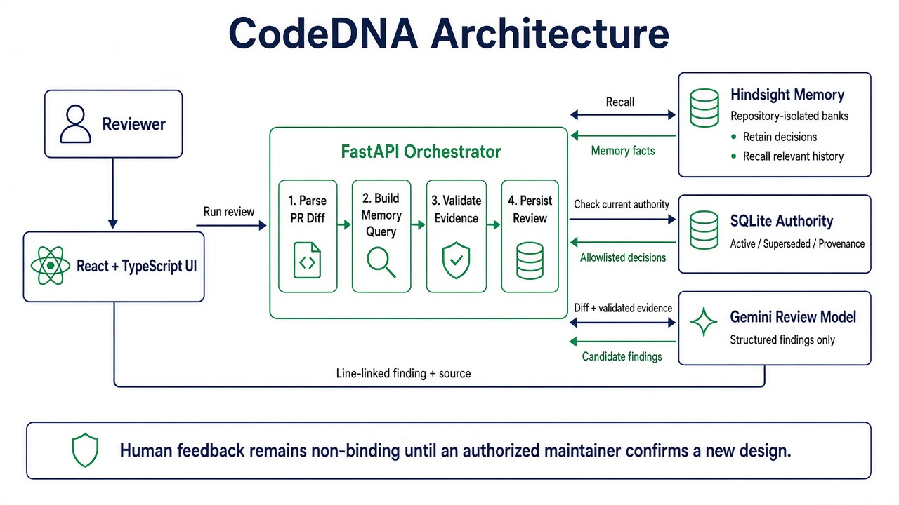

# CodeDNA

**Engineering memory for better code.**

CodeDNA is a repository-aware AI code reviewer that catches changes which compile and work but violate the team’s current architectural decisions. It retains confirmed engineering experience in Hindsight, validates current authority in SQLite, and produces line-linked findings with source provenance.

> Most AI reviewers understand your code. CodeDNA remembers why your team writes it that way.



## Why CodeDNA

Important design decisions are often buried in closed pull requests: required workflows, incident lessons, approved helpers, and conventions that later evolve. A compiler cannot enforce that history, and a generic model should not invent it.

CodeDNA separates memory from authority:

- **Hindsight remembers** semantically relevant historical decisions.
- **SQLite governs** whether a decision is confirmed, active, or superseded.
- **Gemini explains** how an allowlisted current decision applies to the diff.
- **CodeDNA validates** files, added lines, repository scope, and citations before displaying a finding.

## Implemented demo

- Repository overview and isolated Hindsight bank per repository
- Pull-request review with memory or an independent no-memory baseline
- Line-linked design-mismatch findings with validated historical evidence
- Team DNA decision catalog and active/superseded evolution timeline
- Non-binding accept/dismiss feedback
- Memory Lab comparison using the same pull request and model
- Persisted background review and comparison jobs
- Same-job recovery controls after temporary status polling outages, without duplicate provider requests
- Collapsed active-job diagnostics limited to the opaque job ID and human-readable status
- Sanitized started/updated ages with exact local times for active-job diagnosis
- Conservative three-minute no-progress warning that keeps observing the same job without replaying providers
- One warm Hindsight runtime reused by all review clicks
- Latest memory review restored after refreshing the pull-request page
- Latest completed Memory Lab comparison restored after refresh without rerunning providers
- Active Review Workspace and Memory Lab jobs reattached after a same-tab refresh without posting duplicate provider work
- Bounded reconnect for transient job-status failures, with visible review/comparison-specific status and no replacement POST
- Ten-second client timeout for read-only job status/recovery requests; timeout preserves the existing locator or actionable GET-only recovery and never replays creation
- Ambiguity-safe creation timeout with a GET-only `Check creation status` action that resolves active, completed, empty, and failed boundaries without replaying the POST; late-claim and read-outage behavior is regression tested
- Safe stale-job recovery that clears a missing locator and restores the latest persisted same-PR result without rerunning providers
- Read-only same-PR active-job discovery after tab/session loss, before any completed-result fallback
- Atomic same-PR active-job reuse so simultaneous tabs schedule only one provider task
- Explicit Review Workspace and Memory Lab status when a click reattaches to that existing work
- Keyboard focus enters evidence and feedback surfaces, feedback traps focus, Escape closes it, and both surfaces return focus to their trigger
- Review and Memory Lab background stages use one polite, atomic announcement region per page with task-specific completion language
- Finding location controls move keyboard focus to the cited changed line, or to the diff region when no line is available

The synthetic Acme Commerce scenario evolves from `DEC-0042` to active `DEC-0103`. Analytics Service has an isolated UTC-timestamp decision, `DEC-0211`.

## Technology

- React 19, TypeScript, Vite, React Router
- Python 3.12, FastAPI, Pydantic
- SQLAlchemy and SQLite
- Hindsight 1.1 with embedded pg0
- Gemini `gemini-3.1-flash-lite`
- `unidiff`, pytest, Vitest and React Testing Library

## Local setup

Verified on Windows with Python 3.12 and Node 24.

```powershell
python -m venv .venv
.\.venv\Scripts\python.exe -m pip install -e "backend[dev,service]"
if (-not (Test-Path -LiteralPath .env)) {
  Copy-Item -LiteralPath .env.example -Destination .env
}
```

Set `HINDSIGHT_API_LLM_API_KEY` in the ignored `.env`. No paid fallback is selected.

### Start the evolved judge demo

Run the API from `backend`:

```powershell
Set-Location backend
$env:CODEDNA_DEMO_SCENE='evolved'
$env:CODEDNA_HINDSIGHT_AUTOSTART='1'
$env:PYTHONUTF8='1'
$env:PYTHONIOENCODING='utf-8'
..\.venv\Scripts\python.exe -m uvicorn codedna_memory.api:app --host 127.0.0.1 --port 8000
```

The API starts Hindsight once. Wait until `GET http://127.0.0.1:8000/api/health` reports `"hindsight":"ready"` before the demo. With models already on disk, the verified warm-up took 91 seconds. Later review clicks reuse that process instead of starting Hindsight again. The visible browser rechecks ready dependency state every 30 seconds and successful starting/unavailable state every two seconds; each GET aborts after 10 seconds, and consecutive request failures back off at 2/4/8/16/30 seconds. A successful response resets that sequence. Hidden tabs pause checks and reconcile immediately when visible, so a later outage is not left displayed as connected. The indicator shows the latest successful check as a localized semantic timestamp and does not advance it after a failed read. A failed or timed-out application-health request displays `Memory status unknown`; a successful response reporting unavailable Hindsight displays `Memory unavailable`. Both disable memory work, and neither discards the last successful observation. `Check health again` bypasses pending backoff with one application-health GET, disables duplicate activation, and returns focus to the resulting status. These health reads do not start Hindsight or Gemini. If a previous API process stopped during a queued/running review, startup marks that job failed, returns its count as `interrupted_jobs`, and the UI asks for an explicit safe retry instead of duplicating provider calls.

In a second terminal:

```powershell
Set-Location frontend
npm install
npm run dev
```

Open:

- `http://127.0.0.1:5173/` — repository overview
- `http://127.0.0.1:5173/repos/repo-acme-commerce/prs/pr-acme-87` — design-aware review
- `http://127.0.0.1:5173/repos/repo-acme-commerce/dna` — Team DNA
- `http://127.0.0.1:5173/repos/repo-acme-commerce/dna/DEC-0103` — decision evolution
- `http://127.0.0.1:5173/repos/repo-acme-commerce/lab` — Memory Lab

The repository overview includes a read-only Active work panel when queued or running reviews/comparisons exist, or a timestamped `No active work` card after a successful empty check. `Check for active work` can discover work queued in another tab without reloading. Active rows link to their PR and show sanitized job diagnostics. While visible and rows remain, the summary refreshes every five seconds; hidden tabs pause summary reads and reconcile once when visible again. Transient summary failures receive bounded 1/2/4-second retries, followed by an explicit summary-only retry action if needed. Completion is announced conservatively, and keyboard focus follows manual recovery/discovery. The overview never starts work or polls individual job results.

Review Workspace is a named busy region while the selected PR and its active/latest persisted review recovery load. `Run CodeDNA Review` remains disabled until both have completed. Those recovery reads are GET-only, abort after 10 seconds, and a reused active review is announced before existing-job polling completes. Each existing-job status GET has the same 10-second boundary; timeout uses the transient reconnect loop against the unchanged job ID. A recovery failure clears the busy state, states that no provider call was started by recovery, and offers a GET-only saved-recovery retry before the normally gated run control is used. Manual retry focuses restored findings, the recreated retry action after another failure, or the named workspace when no result exists. An empty successful retry is announced politely and explicitly confirms that no provider work started. A creation response also has a 10-second bound, but is never replayed: three GET-only active-claim checks reattach committed work. If none is visible, `Check creation status` keeps creation disabled while it checks the same claim and latest persisted result; active/completed work is restored, a successful empty boundary reenables the explicit run control, and failure remains fail-closed with deterministic focus.

Memory Lab lists both synthetic held-out cases from `GET /api/evaluation-cases` before the run controls. Repository, source PR, candidate PR, active decision, and the newest stored guardrail result are resolved from SQLite; each completed result explicitly says `Passed` or `Needs attention`, then shows its guardrail count, validated opaque comparison job ID, and localized machine-readable update time. Each concise case link has a unique accessible name containing its repository and held-out PR, and the selected case is marked as the current page. Opening a case selects that repository's fetched candidate and does not start a comparison. The named comparison workspace remains busy and `Run comparison` remains disabled until active/latest persisted recovery finishes for that exact selected PR, so recovery cannot race a new or reattached job; those reads and existing-job status GETs abort after 10 seconds and start no provider work. Comparison creation uses the same ambiguity-safe timeout and GET-only claim reconciliation as review creation, never a replacement POST. If automatic claim checks remain inconclusive, the same `Check creation status` active/latest boundary resolves visible, completed, empty, or failed state before another comparison can be requested. A recovery failure clears the busy state, states that neither provider branch was started by recovery, and offers a GET-only saved-recovery retry before comparison creation. That manual retry focuses restored guardrails, the recreated retry action after another failure, or the named workspace when no result exists. An empty successful retry is announced politely and explicitly confirms that neither provider branch started. Temporary catalog failures receive bounded 1/2/4-second GET retries, followed by an explicit GET-only retry action. A healthy catalog can also be refreshed to observe comparisons completed elsewhere, and a local comparison completion refreshes it automatically through the same GET-only boundary. The fixture region has an independent `aria-busy` lifecycle for initial and refresh activity; refreshing keeps trusted rows and their visible `Last checked` time available. Exhausted refreshes explicitly label those rows as last-known-good and repeat the preserved check time; an initial failure cannot claim fallback data. Only a successful GET advances the parseable timestamp. Only manual recovery moves keyboard focus. A material automatic result change is announced with its repository, explicit outcome, and exact guardrail count, while an unchanged result does not duplicate the comparison-complete announcement.

See [docs/DEMO.md](docs/DEMO.md) for the verified presentation path.

## Verification

```powershell
.\.venv\Scripts\python.exe -m pytest backend\tests -q
Set-Location frontend
npm test -- --run
npm run build
```

Latest results:

- Backend: **33 passed**
- Frontend: **57 passed**
- Production frontend build: **passed**
- Live PR #87 memory review: active `DEC-0103` only
- Memory Lab: **6/6 guardrails passed** on each of two repository-isolated synthetic held-out cases

These are controlled demo results, not a generalized accuracy benchmark.

## Additional smoke checks

From `backend`:

```powershell
..\.venv\Scripts\codedna-memory-smoke.exe seed-and-recall --runtime in-process
..\.venv\Scripts\codedna-memory-smoke.exe recall-only --runtime in-process
..\.venv\Scripts\codedna-memory-smoke.exe isolation-check --runtime in-process
..\.venv\Scripts\codedna-review-smoke.exe
..\.venv\Scripts\codedna-policy-smoke.exe
..\.venv\Scripts\codedna-evaluation-smoke.exe
```

The guarded reset is available only for designated synthetic state:

```powershell
..\.venv\Scripts\codedna-demo-reset.exe --confirm-demo-reset
```

## Current limits

- Fixtures are synthetic and the labeled evaluation set is small.
- Gemini free-tier availability can produce transient `429` or `503` failures.
- The first API boot must load local embedding and reranking models.
- Demo authorization is not production authentication or RBAC.
- In-process jobs do not survive an API-process termination.
- Active-job refresh recovery uses per-tab session storage; closing the tab discards its in-progress locator, while completed results remain in SQLite.
- GitHub import and comment posting are future integrations.
