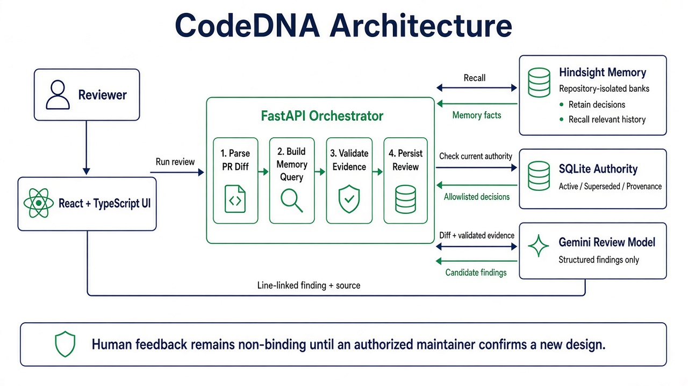

# CodeDNA

**Engineering memory for better code.**

CodeDNA is a repository-aware AI code reviewer that catches changes which compile and work but violate the team’s current architectural decisions. It retains confirmed engineering experience in Hindsight, validates current authority in SQLite, and produces line-linked findings with source provenance.

> Most AI reviewers understand your code. CodeDNA remembers why your team writes it that way.



## Why CodeDNA

Important design decisions are often buried in closed pull requests: required workflows, incident lessons, approved helpers, and conventions that later evolve. A compiler cannot enforce that history, and a generic model should not invent it.

CodeDNA separates memory from authority:

- **Hindsight remembers** semantically relevant historical decisions.
- **SQLite governs** whether a decision is confirmed, active, or superseded.
- **Gemini explains** how an allowlisted current decision applies to the diff.
- **CodeDNA validates** files, added lines, repository scope, and citations before displaying a finding.

## Implemented demo

- Repository overview and isolated Hindsight bank per repository
- Pull-request review with memory or an independent no-memory baseline
- Line-linked design-mismatch findings with validated historical evidence
- Team DNA decision catalog and active/superseded evolution timeline
- Non-binding accept/dismiss feedback
- Memory Lab comparison using the same pull request and model
- Persisted background review and comparison jobs
- One warm Hindsight runtime reused by all review clicks
- Latest memory review restored after refreshing the pull-request page

The synthetic Acme Commerce scenario evolves from `DEC-0042` to active `DEC-0103`. Analytics Service has an isolated UTC-timestamp decision, `DEC-0211`.

## Technology

- React 19, TypeScript, Vite, React Router
- Python 3.12, FastAPI, Pydantic
- SQLAlchemy and SQLite
- Hindsight 1.1 with embedded pg0
- Gemini `gemini-3.1-flash-lite`
- `unidiff`, pytest, Vitest and React Testing Library

## Local setup

Verified on Windows with Python 3.12 and Node 24.

```powershell
python -m venv .venv
.\.venv\Scripts\python.exe -m pip install -e "backend[dev,service]"
if (-not (Test-Path -LiteralPath .env)) {
  Copy-Item -LiteralPath .env.example -Destination .env
}
```

Set `HINDSIGHT_API_LLM_API_KEY` in the ignored `.env`. No paid fallback is selected.

### Start the evolved judge demo

Run the API from `backend`:

```powershell
Set-Location backend
$env:CODEDNA_DEMO_SCENE='evolved'
$env:CODEDNA_HINDSIGHT_AUTOSTART='1'
$env:PYTHONUTF8='1'
$env:PYTHONIOENCODING='utf-8'
..\.venv\Scripts\python.exe -m uvicorn codedna_memory.api:app --host 127.0.0.1 --port 8000
```

The API starts Hindsight once. Wait until `GET http://127.0.0.1:8000/api/health` reports `"hindsight":"ready"` before the demo. With models already on disk, the verified warm-up took 91 seconds. Later review clicks reuse that process instead of starting Hindsight again. If a previous API process stopped during a queued/running review, startup marks that job failed, returns its count as `interrupted_jobs`, and the UI asks for an explicit safe retry instead of duplicating provider calls.

In a second terminal:

```powershell
Set-Location frontend
npm install
npm run dev
```

Open:

- `http://127.0.0.1:5173/` — repository overview
- `http://127.0.0.1:5173/repos/repo-acme-commerce/prs/pr-acme-87` — design-aware review
- `http://127.0.0.1:5173/repos/repo-acme-commerce/dna` — Team DNA
- `http://127.0.0.1:5173/repos/repo-acme-commerce/dna/DEC-0103` — decision evolution
- `http://127.0.0.1:5173/repos/repo-acme-commerce/lab` — Memory Lab

See [docs/DEMO.md](docs/DEMO.md) for the verified presentation path.

## Verification

```powershell
.\.venv\Scripts\python.exe -m pytest backend\tests -q
Set-Location frontend
npm test -- --run
npm run build
```

Latest results:

- Backend: **27 passed**
- Frontend: **16 passed**
- Production frontend build: **passed**
- Live PR #87 memory review: active `DEC-0103` only
- Memory Lab: **6/6 guardrails passed** on each of two repository-isolated synthetic held-out cases

These are controlled demo results, not a generalized accuracy benchmark.

## Additional smoke checks

From `backend`:

```powershell
..\.venv\Scripts\codedna-memory-smoke.exe seed-and-recall --runtime in-process
..\.venv\Scripts\codedna-memory-smoke.exe recall-only --runtime in-process
..\.venv\Scripts\codedna-memory-smoke.exe isolation-check --runtime in-process
..\.venv\Scripts\codedna-review-smoke.exe
..\.venv\Scripts\codedna-policy-smoke.exe
..\.venv\Scripts\codedna-evaluation-smoke.exe
```

The guarded reset is available only for designated synthetic state:

```powershell
..\.venv\Scripts\codedna-demo-reset.exe --confirm-demo-reset
```

## Current limits

- Fixtures are synthetic and the labeled evaluation set is small.
- Gemini free-tier availability can produce transient `429` or `503` failures.
- The first API boot must load local embedding and reranking models.
- Demo authorization is not production authentication or RBAC.
- In-process jobs do not survive an API-process termination.
- GitHub import and comment posting are future integrations.
